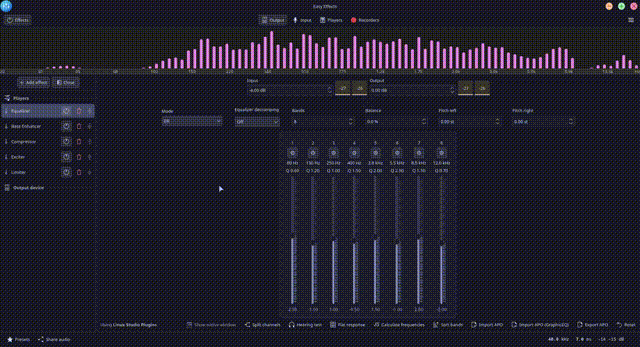

# Audio Configs

EasyEffects presets for Linux audio processing.

## Hardware Profile

| Component | Model |
|-----------|-------|
| Headphones | Audio-Technica ATH-M50x |
| DAC | Fosi Audio K5 Pro USB |
| Microphone | Samson Q9U USB |

## Preview



*ATH-M50x EQ and Samson Q9U mic chain in action.*

## EasyEffects Presets

### Output (Headphones)
- `db/equalizerrc` - ATH-M50x frequency correction
- `db/bassEnhancerrc` - Bass enhancement
- `db/exciterrc` - Harmonic exciter
- `db/limiterrc` - Output limiter

### Input (Microphone)
- `db/gaterc` - Noise gate
- `db/compressorrc` - Compression
- `db/easyeffectsrc` - Main EasyEffects config

## Installation

### Native (pacman)
```bash
cp -r easyeffects/db/* ~/.config/easyeffects/db/
```
Restart EasyEffects after copying.

## Notes

- Built for EasyEffects on PipeWire (CachyOS)
- Native pacman installation (not Flatpak)
- ATH-M50x EQ compensates for bass boost and harsh highs

## Support

[](https://ko-fi.com/U1U82AQ6S8)

If you find these presets useful and want to support independent FOSS work, consider buying me a coffee. All contributions go toward hardware and infrastructure costs.

## License

[GPL v3](LICENSE)
